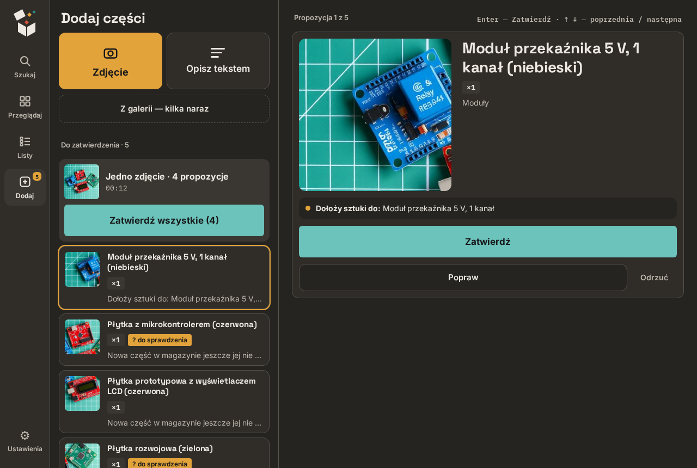
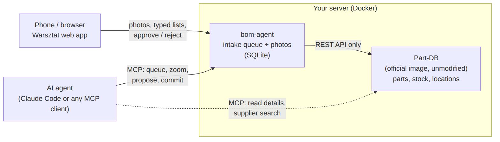

# partdb-photo-intake

**Photograph a box of electronic parts with your phone, let an AI agent recognise them, approve with one tap — and they land in [Part-DB](https://github.com/Part-DB/Part-DB-server).**

A companion service for Part-DB. Part-DB stays the single source of truth and runs unmodified from its official image; this project sits next to it and talks to it only through its REST API.

*Polska wersja skrócona: [README.pl.md](README.pl.md).*



## Why

Entering a few hundred parts into an inventory by hand is the step where most home inventories die. Taking a photo takes two seconds; typing name, category, quantity and box takes a minute. This project moves the typing to an AI agent and leaves the human with the part only the human can do: holding the thing, taking the picture, and saying "yes, that's right".

The second goal: when you design a circuit together with an AI agent, the agent should **check what is already in your boxes** before it suggests buying anything. The MCP tool `inventory_digest` gives it the whole inventory in one compact text.

## What it does

- **Phone web app ("Warsztat")** — take a photo or several angles of the same part, pick the box, add a note ("10 pcs"), or type a quick list ("BC557 TO-92 10 pcs"). Works offline: unsent photos wait and go out when you are back on Wi-Fi.
- **MCP server for the agent** — 9 tools: read the queue, zoom into the original photo, propose or commit parts, assign boxes, fill in datasheets and pictures from TME / LCSC, record the source of modules bought in web shops.
- **Two ways to recognise:** in a chat session (agent shows a plan, you say yes), or unattended — tap **Rozpoznaj** ("recognise") in the app and an hourly job writes *proposals* that you approve in the app. The unattended agent has **no write access** to the inventory.
- **Several parts on one photo** — each gets its own crop of the picture, so the part list does not show the same group photo five times.
- **Duplicate detection** — a recognised part that already exists gets more stock instead of a second record.
- **Inventory browser** — search, categories, boxes, worklists ("no box yet", "to check", "no datasheet"), part card with photos, quantity and "−1, I took one".



## Documentation

| Chapter | What is inside |
|---|---|
| [1. Requirements](docs/01-requirements.md) | what you need before you start |
| [2. Installation](docs/02-installation.md) | Part-DB + bom-agent with Docker Compose, first login, API token, HTTPS |
| [3. Connecting the AI agent](docs/03-connect-agent.md) | MCP configuration for Claude Code (or another MCP client) |
| [4. Daily use](docs/04-daily-use.md) | photo → proposal → approval; the app screen by screen |
| [5. Unattended recognition](docs/05-unattended-recognition.md) | optional hourly job with `claude -p` |
| [6. Troubleshooting](docs/06-troubleshooting.md) | symptom → cause → fix |
| [7. How it works](docs/07-how-it-works.md) | code map, design decisions, known pitfalls |

## Shortest path

About 30–45 minutes if you already have Docker, longer if you also set up HTTPS.

```bash
git clone https://github.com/szmidtpiotr/partdb-photo-intake.git
cd partdb-photo-intake/deploy
cp .env.example .env          # fill in: secret, admin password, host names
docker compose up -d partdb
docker compose exec --user www-data partdb php bin/console doctrine:migrations:migrate -n
# log in to Part-DB, change the password, allow API access, create an API token
# put the token into .env, then:
docker compose up -d --build
```

Step by step with explanations: [Installation](docs/02-installation.md).

## Project status

- **Works and is used daily** on a real home workshop inventory (~600 parts) with Part-DB 2.20.5.
- **The interface is in Polish.** The documentation translates every label it mentions. Translating the app itself is not done.
- **No login in bom-agent.** Anyone who can reach its port can add photos and edit stock. Keep it in your home network or behind a reverse proxy with authentication — see [Installation, step 7](docs/02-installation.md#7-https-and-access-from-the-phone).
- Tested with Claude Code as the MCP client. Other MCP clients should work, but this has not been tested.
- The screenshots show an **invented** inventory; the component photos in them were generated with an image model.

## Repository layout

```
bom_agent/        Python service: web API for the app + MCP server
  partdb_client.py  the ONLY module that talks to Part-DB's API
  mcp_server.py     MCP tools for the agent (stdio)
  web.py            HTTP API and static files for the app
  intake/           queue, proposals, commit, photo crops
pwa/              the phone/desktop web app (plain JS, no build step)
deploy/           docker-compose.yml, .env.example, backup.sh
scripts/          unattended recognition job, smoke tests
tests/            pytest suite (runs offline, no Part-DB needed)
tools/            screenshot script for the documentation
docs/             this documentation
```

## License

No license has been chosen yet, so by default all rights are reserved. Ask the author if you want to reuse the code.
