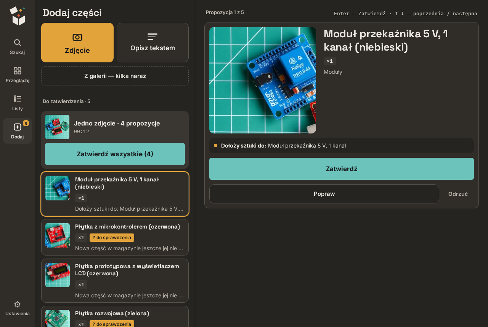

# partdb-photo-intake

**Robisz telefonem zdjęcie części elektronicznych, agent AI je rozpoznaje, zatwierdzasz jednym dotknięciem — i trafiają do [Part-DB](https://github.com/Part-DB/Part-DB-server).**

To usługa towarzysząca dla Part-DB. Part-DB pozostaje jedynym źródłem prawdy i działa bez zmian z oficjalnego obrazu; ten projekt stoi obok i rozmawia z nim wyłącznie przez REST API.

## Po co

Ręczne wpisanie kilkuset części to moment, w którym umiera większość domowych magazynów. Zdjęcie trwa dwie sekundy, przepisanie nazwy, kategorii, ilości i pudełka — minutę. Ten projekt przenosi przepisywanie na agenta AI, a człowiekowi zostawia to, czego agent nie zrobi: trzymanie rzeczy w ręce, zdjęcie i „tak, zgadza się”.

Drugi cel: projektując układ razem z agentem, agent najpierw sprawdza, co leży w pudełkach, a dopiero potem proponuje zakupy.

## Co umie

- aplikacja na telefon „Warsztat”: zdjęcia (także kilka ujęć jednej rzeczy), wybór pudełka, notatka, spis tekstem; działa bez zasięgu,
- serwer MCP z 9 narzędziami dla agenta,
- rozpoznawanie w rozmowie albo bez nadzoru (przycisk **Rozpoznaj** + automat co godzinę, który zapisuje tylko propozycje),
- kilka części na jednym zdjęciu, każda z własnym wycinkiem,
- wykrywanie duplikatów, uzupełnianie datasheetów i zdjęć z TME/LCSC,
- przeglądarka magazynu: szukanie, kategorie, pudełka, listy robocze, karta części.

## Dokumentacja

Pełna instrukcja jest po angielsku, bo projekt jest pokazywany społeczności Part-DB: zacznij od [README.md](README.md) i [instalacji](docs/02-installation.md). Interfejs aplikacji jest po polsku.

## Stan

Używany na co dzień w domowym warsztacie (~600 części), Part-DB 2.20.5. Usługa `bom-agent` nie ma logowania — trzymaj ją w sieci domowej albo za reverse proxy z uwierzytelnianiem. Zrzuty ekranu pokazują wymyślony magazyn, a zdjęcia części na nich wygenerował model AI.

Licencja nie została wybrana — domyślnie wszystkie prawa zastrzeżone.
