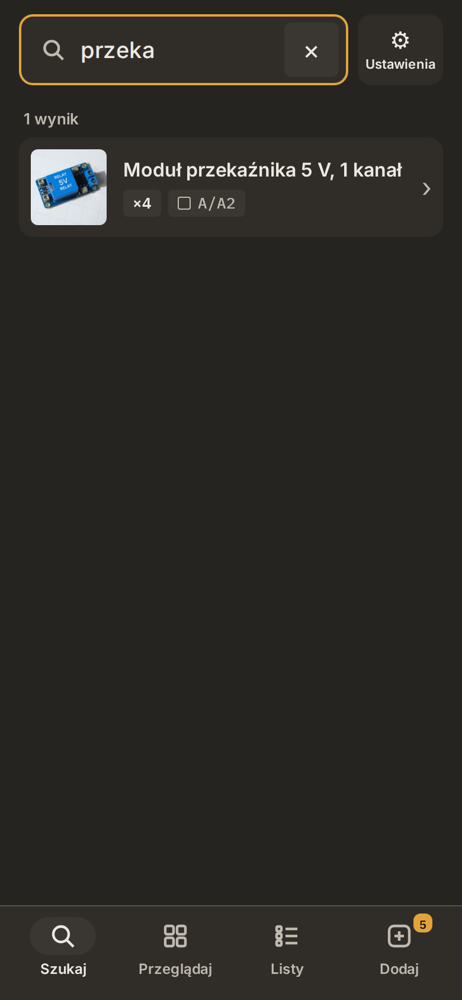
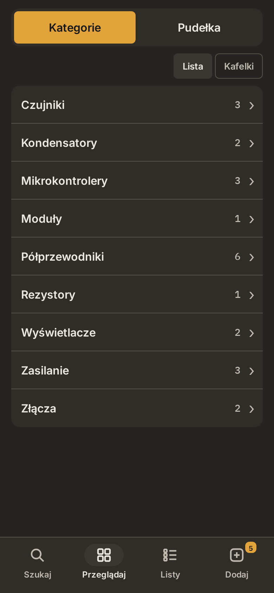
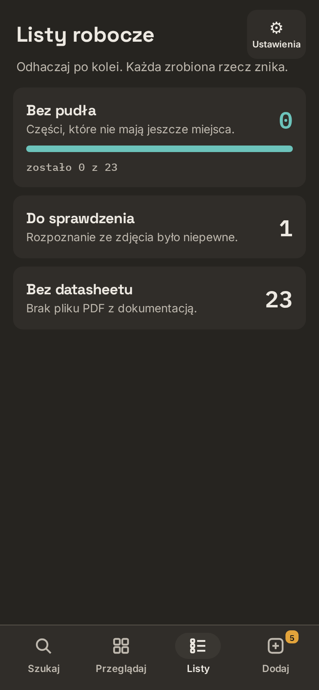
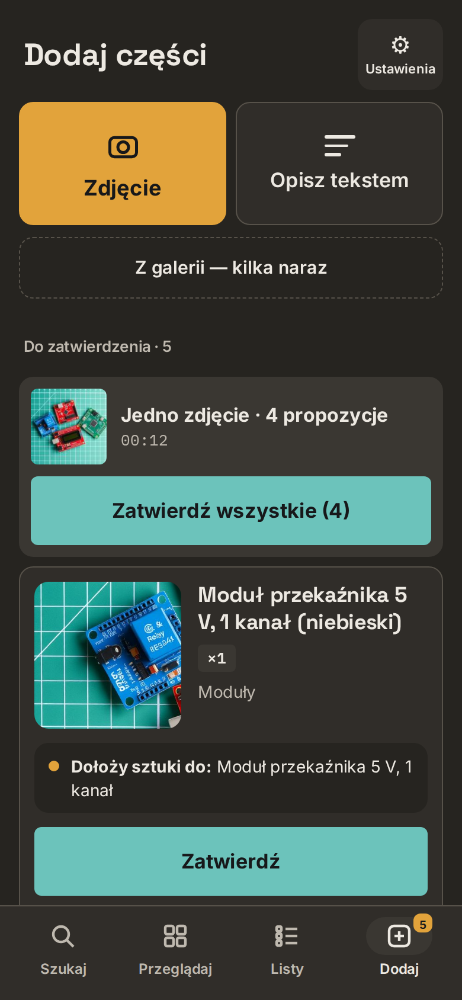
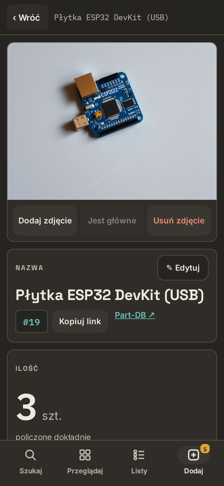
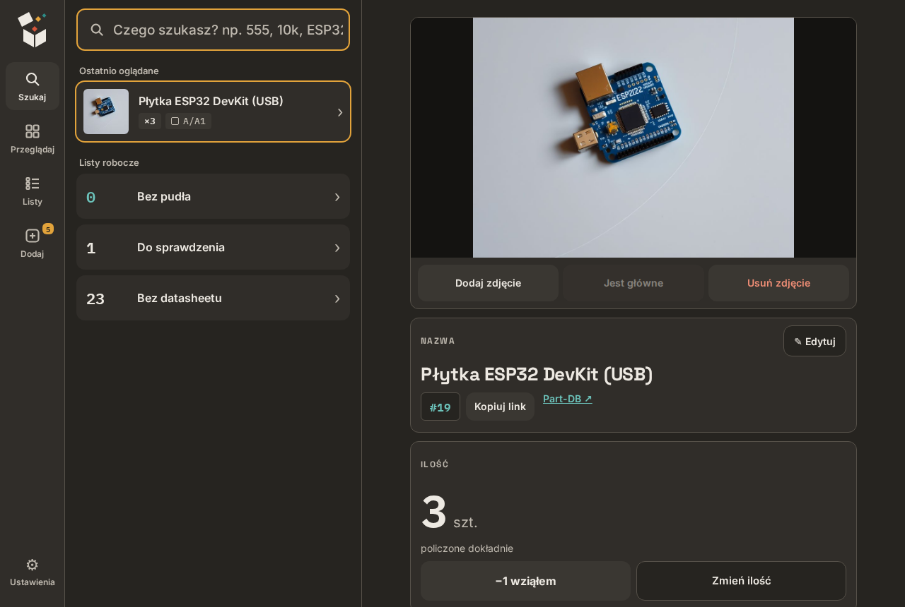

# 4. Daily use

The app is in Polish. Labels used below are given as **Polish label** (English meaning).

## The four tabs

| Tab | What it is |
|---|---|
| **Szukaj** (Search) | search box, recently viewed parts, worklists |
| **Przeglądaj** (Browse) | categories and boxes (**Kategorie** / **Pudełka**) |
| **Listy** (Lists) | worklists: **Bez pudła** (no box yet), **Do sprawdzenia** (to check), **Bez datasheetu** (no datasheet) |
| **Dodaj** (Add) | taking photos, the queue and the proposals to approve |

<p>



</p>

## Adding parts

1. Tab **Dodaj**, button **Zdjęcie** (Photo). Or **Z galerii — kilka naraz** (from gallery, several at once), or **Opisz tekstem** (describe in text) for a typed list such as:
   ```
   box B2
   capacitor 10 µF 50 V 20 pcs
   transistor BD139 5 pcs
   ```
2. Optional, per photo: add another angle of the **same** part (the bottom side, a close-up of the marking), choose the box, add a note. A note is trusted more than the photo — "10 pcs" in a note becomes a counted quantity.
3. The photo waits in the queue (**Czeka**, waiting).

Photos taken without signal wait in the phone and are sent when the connection is back.

## Recognition — option A: in a chat

Tell the agent: *"Recognise what is in the intake queue."* It looks at the photos (zooming into markings when needed), shows a plan — new part or more stock of an existing one, category, quantity, box — and saves after you say yes.

## Recognition — option B: approve in the app

1. In the queue tap **Rozpoznaj** (recognise) on the items you are done with. Not earlier — you may still want to add the bottom side.
2. The unattended job ([chapter 5](05-unattended-recognition.md)) — or an agent in a chat calling `intake_propose` — writes proposals.
3. They appear under **Do zatwierdzenia** (to approve). Each card shows the crop of the photo with *that one* part, the name, quantity, category and what will happen (new part / add stock to an existing one).
4. Per card: **Zatwierdź** (approve), **Popraw** (fix) or **Odrzuć** (reject). For a group photo there is **Zatwierdź wszystkie** (approve all).



On a computer the same screen has the list on the left and the selected proposal on the right; **Enter** approves, the arrow keys move between proposals.

## The part card

Photos (yours and catalogue ones), name, quantity and box, category, description, notes, documents (datasheet, shop page).

- **−1 wziąłem** (−1, I took one) and **Zmień ilość** (change quantity) for stock.
- **Sprawdzone** (checked) clears the "to check" flag that the agent sets when it was not sure.
- **Part-DB ↗** opens the same part in Part-DB.

<p>

</p>



## Quantities

Small parts are not counted one by one. The agent records them as *about*: **mało** (a few, under 10), **sporo** (quite a lot, 10–100), **dużo** (lots, over 100), and Part-DB marks the stock as "amount unknown". A number from your note or your typed list is stored as an exact count.

## Boxes

Parts registered without a box land in the worklist **Bez pudła**. Create boxes in **Przeglądaj → Pudełka** (**Nowe pudełko**, new box), then either ask the agent to put the listed parts into a box (`assign_location`) or use **Przenieś** (move) on the part card.

---

Next: [5. Unattended recognition](05-unattended-recognition.md)
